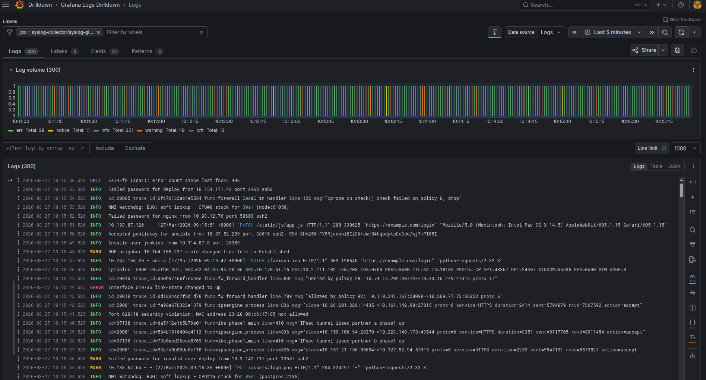

# opentelemetry-syslog-collector

Receives syslog messages with [syslog-ng](https://www.syslog-ng.com/) and sends them as logs with the [OpenTelemetry Collector](https://opentelemetry.io/docs/collector/).

The chart needs the [opentelemetry-operator](https://github.com/open-telemetry/opentelemetry-operator).

## Example

Send the syslog messages to an OpenTelemetry gateway:

```yaml
configOverrides:
  exporters:
    otlp_http:
      endpoint: http://opentelemetry-gateway-logs.opentelemetry-gateway:4318
      headers:
        x-scope-orgid: my-tenant
```

## Ports and protocols

syslog-ng listens with [`default-network-drivers()`](https://www.syslog-ng.com/technical-documents/doc/syslog-ng-open-source-edition/3.38/administration-guide/31). The Services expose these ports:

| Service | Port | Transport | Protocol | Framing | Format |
|---|---|---|---|---|---|
| `tcpudp`, `udp` | 514 | UDP | BSD ([RFC 5426](https://datatracker.ietf.org/doc/html/rfc5426)) | Datagram | [RFC 3164](https://datatracker.ietf.org/doc/html/rfc3164) or [RFC 5424](https://datatracker.ietf.org/doc/html/rfc5424), detected per message |
| `tcpudp`, `tcp` | 514 | TCP | BSD ([RFC 6587](https://datatracker.ietf.org/doc/html/rfc6587)) | Newline-delimited | [RFC 3164](https://datatracker.ietf.org/doc/html/rfc3164) or [RFC 5424](https://datatracker.ietf.org/doc/html/rfc5424), detected per message |
| `tcpudp`, `tcp` | 601 | TCP | IETF ([RFC 6587](https://datatracker.ietf.org/doc/html/rfc6587)) | Octet-counting | [RFC 5424](https://datatracker.ietf.org/doc/html/rfc5424) only |

> **Warning:** With the `tcpudp` Service, use one transport (UDP or TCP) for each source host. When one host uses both transports, messages can get lost.

### Test

Send a test message to port 514 with `logger`:

```bash
logger --server <host> -P 514 --tcp --rfc3164 "test message"
logger --server <host> -P 514 --udp --rfc5424 "test message"
```

Send a test message to port 601:

```bash
logger --server <host> -P 601 --tcp --rfc5424 --octet-count "test message"
```

## Loadgen

The optional load generator sends syslog messages in both formats from 7 simulated sources: firewall, switch, sshd, sudo, kernel, nginx, and postfix.

```yaml
loadgen:
  enabled: true
  rate: 10
```

`rate` is the number of messages per second. Each profile under `loadgen.profiles` has an `enabled` flag and a `weight`. The weight sets the share of the profile in the rate.


